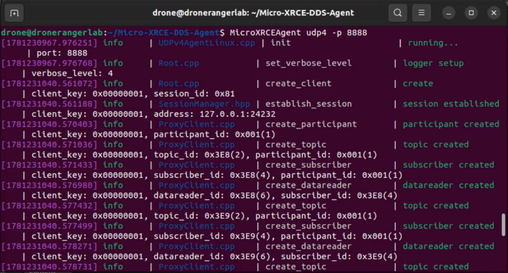
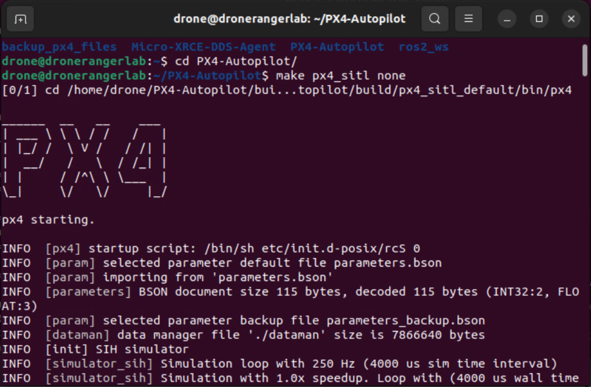
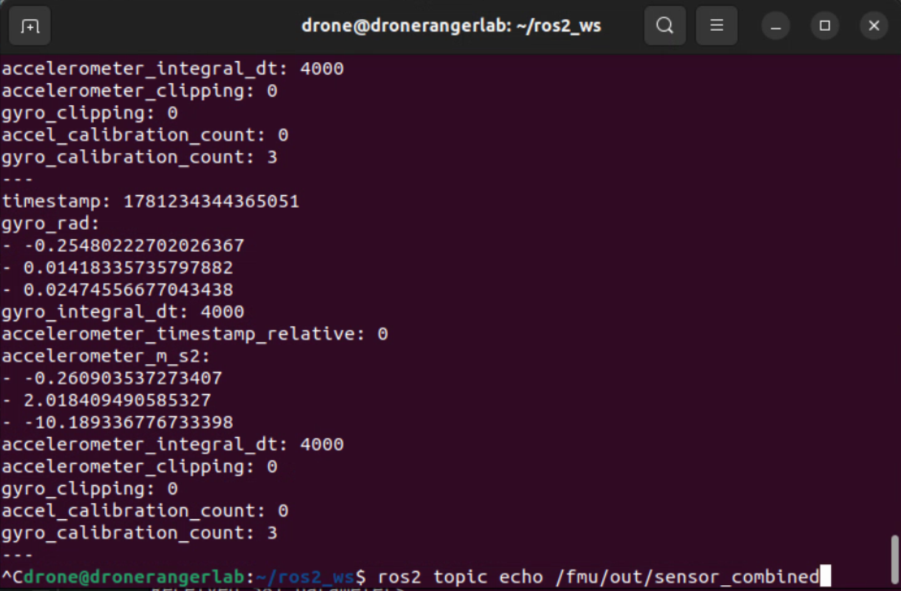
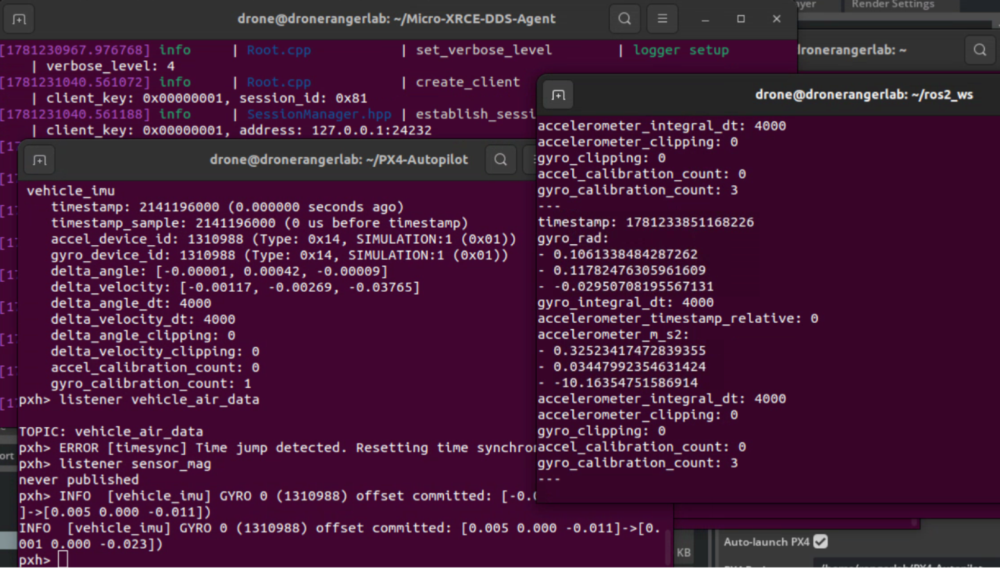

# PX4 SITL + uXRCE-DDS + ROS 2 (without Isaac Sim)

Communication pipeline:

```
PX4 (uxrce_dds_client) -> MicroXRCEAgent -> ROS 2 (/fmu/in/*, /fmu/out/*)
```

> **How this relates to Pegasus / Isaac Sim**
>
> This page builds PX4 and checks the PX4 → ROS 2 link **on its own**, with no simulator (`none` target).
> It is the first half of the full simulation setup.
> When you run Isaac Sim + Pegasus, Pegasus **launches this same PX4 build for you** and feeds it the simulated sensors.
> Do not also run `make px4_sitl none` by hand at that point.
> Continue with [pegasus.md](pegasus.md) after this page works.

Versions used here (must match [pegasus.md](pegasus.md#0-version-matrix)):

| Component | Version |
|---|---|
| Ubuntu | 22.04 x86_64 |
| PX4-Autopilot | v1.14.3 |
| px4_msgs | branch `release/1.14` |
| Micro-XRCE-DDS-Agent | v2.4.2 |
| ROS 2 | Humble |

### 0. Prepare Linux environment

```bash
sudo apt update && sudo apt upgrade -y
# Create a normal account (do not use root for this whole process, the PX4 scripts will complain)
sudo adduser drone
sudo usermod -aG sudo drone
su - drone
```

Verify the environment:

```bash
uname -m        # should be x86_64
lsb_release -a  # should be Ubuntu 22.04
```

### 1. Install PX4-Autopilot

**1. Clone the repository at the pinned version (the version Pegasus is tested with)**

```bash
cd ~
git clone https://github.com/PX4/PX4-Autopilot.git --recursive
cd PX4-Autopilot
git checkout v1.14.3
git submodule update --init --recursive
```

> v1.14.3 is the version tested by Pegasus Simulator for Isaac Sim 5.1.0. Do not use `main`.
> The Gazebo submodules are downloaded too but are not needed; Isaac Sim + Pegasus replaces Gazebo as the simulator.

**2. Run the official dependency script (installs compilers and Python packages, takes several minutes)**

```bash
bash ./Tools/setup/ubuntu.sh
```

⚠️ After the script finishes, log in again so the new environment variables take effect:

```bash
exit
su - drone   # or reconnect through SSH
```

**3. Install Python dependencies**

```bash
pip3 install --user kconfiglib jinja2 jsonschema pyros-genmsg \
     packaging toml numpy future empy==3.3.4
```

**4. Compile SITL (`none` = no simulator GUI, pure flight-control logic)**

```bash
cd ~/PX4-Autopilot
make px4_sitl_default none
```

The first build takes about 5–10 minutes. Success sign:

```
[100%] Built target px4
```

### 2. First run of PX4 SITL

```bash
# Start PX4 directly (enters the pxh> interactive shell)
cd ~/PX4-Autopilot
make px4_sitl_default none
```

Expected output:

```
INFO  [px4] Startup script returned successfully
______  __   __    ___
| ___ \ \ \ / /   /   |
| |_/ /  \ V /   / /| |
|  __/   /   \  / /_| |
| |     / /^\ \ \___  |
\_|     \/   \/     |_/

px4 starting.
...
pxh>
```

Reaching `pxh>` means PX4 SITL started successfully. Some useful commands:

```bash
commander status            # flight-control status
param show SYS_AUTOSTART    # airframe parameter
help                        # all commands
shutdown                    # exit
```

### 3. Install ROS 2 Humble

> If ROS 2 Humble is already installed (for example by following [ROS2 Bridge setup.md](<ROS2 Bridge setup.md>)), skip to step 4.

**1. Set locale**

```bash
sudo apt install -y locales
sudo locale-gen en_US en_US.UTF-8
sudo update-locale LC_ALL=en_US.UTF-8 LANG=en_US.UTF-8
export LANG=en_US.UTF-8
```

**2. Add the ROS 2 apt source**

```bash
sudo apt install -y software-properties-common curl
sudo add-apt-repository universe -y
sudo curl -sSL https://raw.githubusercontent.com/ros/rosdistro/master/ros.key \
     -o /usr/share/keyrings/ros-archive-keyring.gpg
echo "deb [arch=$(dpkg --print-architecture) \
     signed-by=/usr/share/keyrings/ros-archive-keyring.gpg] \
     http://packages.ros.org/ros2/ubuntu \
     $(. /etc/os-release && echo $UBUNTU_CODENAME) main" \
     | sudo tee /etc/apt/sources.list.d/ros2.list > /dev/null
```

**3. Install ROS 2 Humble (base version, no GUI)**

```bash
sudo apt update
sudo apt install -y ros-humble-ros-base python3-colcon-common-extensions
```

**4. Source ROS 2 automatically on every login**

```bash
echo "source /opt/ros/humble/setup.bash" >> ~/.bashrc
source ~/.bashrc
```

Verify (at this point only the default topics exist; the `/fmu/*` topics appear after step 6):

```bash
ros2 topic list
# /parameter_events
# /rosout
```

### 4. Install Micro XRCE-DDS Agent

This is the bridge between PX4 and ROS 2: PX4's internal uORB data is published as ROS 2 topics through it.

```bash
cd ~
git clone -b v2.4.2 https://github.com/eProsima/Micro-XRCE-DDS-Agent.git
cd Micro-XRCE-DDS-Agent
mkdir build && cd build
cmake ..
make -j$(nproc)
sudo make install
sudo ldconfig /usr/local/lib/
```

Verify (printing the help text means the install succeeded):

```bash
MicroXRCEAgent --help
```

### 5. Install px4_msgs

ROS 2 needs the PX4 message definitions to decode the data PX4 publishes.
**The `px4_msgs` branch must match the PX4 version**: for PX4 v1.14.3 use `release/1.14`.
The default `main` branch follows PX4 `main`; with v1.14.3 its topics show up but cannot be decoded, or `ros2 topic echo` prints nothing.

```bash
mkdir -p ~/ros2_ws/src && cd ~/ros2_ws/src
git clone -b release/1.14 https://github.com/PX4/px4_msgs.git
cd ~/ros2_ws
source /opt/ros/humble/setup.bash
colcon build --symlink-install
echo "source ~/ros2_ws/install/setup.bash" >> ~/.bashrc
source ~/.bashrc
```

### 6. Three-terminal check: end-to-end data flow

Open three terminals (or SSH sessions):

***Terminal 1***: start the XRCE-DDS Agent

```bash
MicroXRCEAgent udp4 -p 8888
```

Keep it running and wait for PX4 to connect.



***Terminal 2***: start PX4 SITL

```bash
cd ~/PX4-Autopilot
make px4_sitl_default none
```

PX4 v1.14 SITL starts `uxrce_dds_client` automatically (UDP, `127.0.0.1:8888`), so there is nothing to type in `pxh>`.
After a few seconds, terminal 1 should print something like:

```
[1711234567.123456] info     | ProxyClient.cpp | create_client | ... | client_key: 0xDEADBEEF
```



This means PX4 and the DDS Agent are connected.

***Terminal 3***: check the ROS 2 data

```bash
source /opt/ros/humble/setup.bash
source ~/ros2_ws/install/setup.bash
ros2 topic list
```

Expected output (excerpt):

```
/fmu/in/obstacle_distance
/fmu/in/offboard_control_mode
/fmu/in/trajectory_setpoint
/fmu/in/vehicle_command
/fmu/in/vehicle_visual_odometry
...
/fmu/out/failsafe_flags
/fmu/out/sensor_combined
/fmu/out/timesync_status
/fmu/out/vehicle_attitude
/fmu/out/vehicle_local_position
/fmu/out/vehicle_odometry
/fmu/out/vehicle_status
/parameter_events
/rosout
```

Check the real-time position of the drone (on the ground, x/y/z should be about 0):

```bash
ros2 topic echo /fmu/out/vehicle_local_position
```

In terminal 2 (`pxh>`), arm and take off:

```bash
commander arm
commander takeoff
```

Back in terminal 3, `z` in `/fmu/out/vehicle_local_position` should change (PX4 uses NED, so `z` becomes negative while climbing).



This shows that data flows through the whole chain.

> With `none` there is no physics simulator, so PX4 is not flying a real vehicle model.
> This test only proves the PX4 → DDS → ROS 2 link. Physical flight comes from Isaac Sim + Pegasus ([pegasus.md](pegasus.md)).

### 7. Use the MAVLink shell to look further (optional)

In a new terminal:

```bash
python3 ~/PX4-Autopilot/Tools/mavlink_shell.py 0.0.0.0:14550
```

Check sensor data:

```bash
listener sensor_baro            # barometer (simulated by Pegasus when running in Isaac Sim)
listener sensor_mag             # magnetometer
listener sensor_accel           # accelerometer
listener vehicle_gps_position   # GPS
```

## Summary

```
Ubuntu 22.04
├── Terminal 1: MicroXRCEAgent udp4 -p 8888
│                    ↕ UDP :8888 (uXRCE-DDS)
├── Terminal 2: make px4_sitl_default none  →  pxh> commander arm / takeoff
│
└── Terminal 3: ros2 topic echo /fmu/out/vehicle_local_position
```


